1. Testing Environment Preparation
- Local application deployment.
- Kali Linux VM and Windows host connectivity.
- Temporary firewall changes.
- Frontend and backend network binding.
- Temporary CORS configuration.

after deploying I found the app wasn't reached from vm 
and when using nmap the service was closed so I changed some settings

`nmap 192.168.1.20 -sC -sV --top-ports=1000` 
here i wanted to see if there were any ports seen on my device locally but not important as that was expected 
didnt get any thing cause of the vm/host connectivity wasn't ready

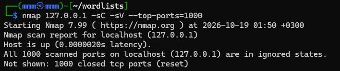

so i found that the firewall is defending from icmp 
so we 
`Enable-NetFirewallRule -Name "FPS-ICMP4-ERQ-In"`
we will disable it later

also we changed the 
`ng serve --host 0.0.0.0 --port 4200` to make it accessable to any ipv4
but will add a firewall condition 
```
New-NetFirewallRule `
  -DisplayName "Angular Dev Server 4200 (Lab)" `
  -Direction Inbound `
  -Protocol TCP `
  -LocalPort 4200 `
  -Action Allow `
  -Profile Private
```
`we will delete the rule at the end `

```
Remove-NetFirewallRule -DisplayName "Angular Dev Server 4200 (Lab)"
```

also changed in program.cs file cors 
```
options.AddPolicy("AllowAngularApp", policy =>

    {
        policy.SetIsOriginAllowed(_ => true)})
```
A temporary permissive CORS policy was configured to facilitate cross-origin testing from the virtual machine. This configuration was used exclusively for the isolated lab and was not considered suitable for production deployment. Its security implications were noted for subsequent testing.


2. Initial Network Reconnaissance
- Initial Nmap scan.
- Targeted port scanning.
- NSE script results.
- TLS certificate information.
- HTTP/2 and HTTP/1.1 support.
- Vite and Kestrel identification.


test with nmap now `nmap -sC -sV -n -Pn -sT -p 4200,5001 --reason ip `
where -sC for basic scripts of nmap NSE  , -sV for version of service , -Pn for no ping , -sT for tcp , --reason for state of service 

```
PORT     STATE SERVICE             REASON  VERSION
4200/tcp open  ssl/vrml-multi-use? syn-ack
|_ssl-date: TLS randomness does not represent time
| ssl-cert: Subject: organizationName=mkcert development certificate
| Subject Alternative Name: DNS:localhost
| Not valid before: 2025-04-12T12:11:45
|_Not valid after:  2027-07-12T11:11:45
| tls-alpn: 
|   h2
|_  http/1.1
| fingerprint-strings: 
|   DNSStatusRequestTCP, DNSVersionBindReqTCP, RPCCheck: 
|     HTTP/1.1 400 Bad Request
|   GetRequest: 
|     HTTP/1.1 200 OK
|     Vary: Origin
|     Content-Type: text/html
|     Cache-Control: no-cache
|     Date: Mon, 19 Oct 2026 19:10:10 GMT
|     Connection: close
|     <!doctype html>
|     <html lang="en" class="custom-theme">
|     <head>
|     <script type="module" src="/@vite/client"></script>
|     <meta charset="utf-8">
|     <title>FinalTouch</title>
|     <base href="/">
|     <meta name="viewport" content="width=device-width, initial-scale=1">
|     <link rel="icon" type="image/x-icon" href="favicon.ico">
|     <link href="https://fonts.googleapis.com/css2?family=Roboto:wght@300;400;500&amp;display=swap" rel="stylesheet">
|     <link href="https://fonts.googleapis.com/icon?family=Material+Icons" rel="stylesheet">
|     <link rel="stylesheet" href="styles.css"></head>
|     <body>
|     <div id="initial-splash">
|     <div class="flex items-center justify-center h-screen">
|     <div class="flex-col items-center align-middle">
|     </div>
|     </div>
|   RTSPRequest: 
|     HTTP/1.1 404 Not Found
|     Vary: Origin, Access-Control-Request-Headers
|     Access-Control-Allow-Methods: GET,HEAD,PUT,PATCH,POST,DELETE
|     Content-Security-Policy: default-src 'none'
|     X-Content-Type-Options: nosniff
|     Content-Type: text/html; charset=utf-8
|     Content-Length: 143
|     Date: Mon, 19 Oct 2026 19:10:10 GMT
|     Connection: close
|     <!DOCTYPE html>
|     <html lang="en">
|     <head>
|     <meta charset="utf-8">
|     <title>Error</title>
|     </head>
|     <body>
|     <pre>Cannot OPTIONS /</pre>
|     </body>
|_    </html>
5001/tcp open  ssl/commplex-link?  syn-ack
| ssl-cert: Subject: commonName=localhost
| Subject Alternative Name: DNS:localhost, DNS:*.dev.localhost, DNS:*.dev.internal, DNS:host.docker.internal, DNS:host.containers.internal, IP Address:127.0.0.1, IP Address:0:0:0:0:0:0:0:1
| Not valid before: 2026-08-06T17:26:20
|_Not valid after:  2027-08-06T17:26:20
| fingerprint-strings: 
|   FourOhFourRequest: 
|     HTTP/1.1 404 Not Found
|     Content-Length: 0
|     Connection: close
|     Date: Mon, 19 Oct 2026 19:10:35 GMT
|     Server: Kestrel
|   GetRequest, HTTPOptions: 
|     HTTP/1.1 404 Not Found
|     Content-Length: 0
|     Connection: close
|     Date: Mon, 19 Oct 2026 19:10:09 GMT
|     Server: Kestrel
|   Help, Kerberos: 
|     HTTP/1.1 400 Bad Request
|     Content-Length: 0
|     Connection: close
|     Date: Mon, 19 Oct 2026 19:10:25 GMT
|     Server: Kestrel
|   LDAPSearchReq: 
|     HTTP/1.1 400 Bad Request
|     Content-Length: 0
|     Connection: close
|     Date: Mon, 19 Oct 2026 19:10:35 GMT
|_    Server: Kestrel
| tls-alpn: 
|   h2
|_  http/1.1
|_ssl-date: TLS randomness does not represent time
```

from what we found :
http/1.1 200 ok so the server returned the frontend html
/@vite/client : it uses vite development in client being injected to the page
the server uses tls cert for local host
endpoint advertise both http/2 and http/1.1 
also 
server kestrel the responses identity asp.net core kestrel web server


3. Web Content Discovery
- ffuf experiments.
- Gobuster directory enumeration.
- SPA fallback behavior and response-length filtering.
- Discovered paths and their responses.
- Path disclosure observation.


we used gobuster as ffuf didnt get much also i dont like i preferer gobuster 
`gobuster dir -k -u https://192.168.1.20:4200/ -w ~/Downloads/DirBuster-2007_directory-list-2.3-medium.txt -t 10 -x php,txt,html,bak,zip --exclude-length 909` 
here we added the -k and --exclude-length 909 
as the site itself return 200 ok when use a random path like `192.168.1.20:4200/ffe99dfc-931f-47a9-a450-e9e9b9d1adbf`
as the length of returned page was 909 so the buster returned that as in this case every thing will return 200 as a fallback to the main html page when unknown path is used as here so 909 refer to the main html size to skip it
good note to consider

now the result shows 


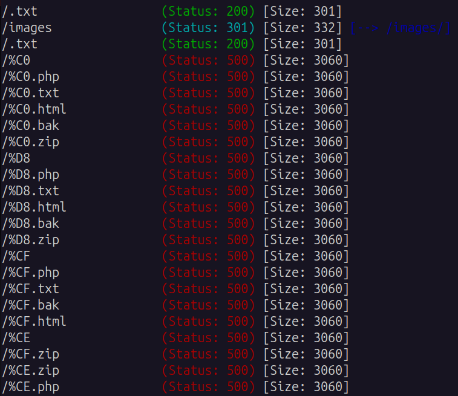
as we see here like an ordinary list used here to see if we could reach a path 
only got like 3 findings :

1-
/.txt
```

export default "/@fs/.txt"
//# sourceMappingURL=

```
not much 

2-
also the 500 respond here  like url + %DF  which is this char ß  it wont matter much but still it formed a leak in the site  
showed something interesting the location of every calling 

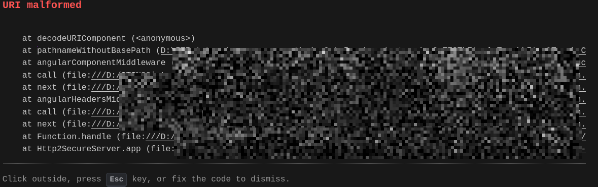
this pop up on the site suddenly although its a development phase so i shouldnt confirm yet but still it may be the same in production 
consider leak even on burp also shows 
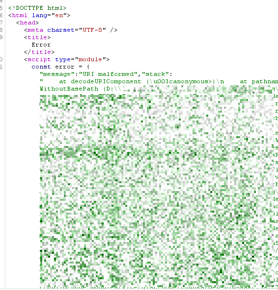

this is an information disclosure as it shouldnt reveal the output of the exact location of this files 
i should update to the latest version


3-
even the /images although
it make a 301 and return to a 404 crafted page 
if i tried to /images/1.jpg   
it will show the image
and if opened in burp 
it showed some extra info (i know it could be seen by other tools or with metadata of the image but any ways)
like author, the date it was made in
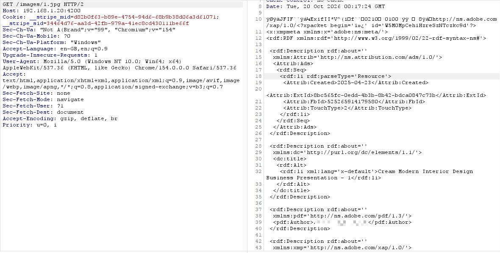


i tried to do path traverse but didnt work 


4. Technology Fingerprinting and Passive Reconnaissance
- Wappalyzer results.
- robots.txt inspection.
- Historical URL discovery using Wayback, if applicable.

wappalizer to see if it could recognize the site tools or code used or framework
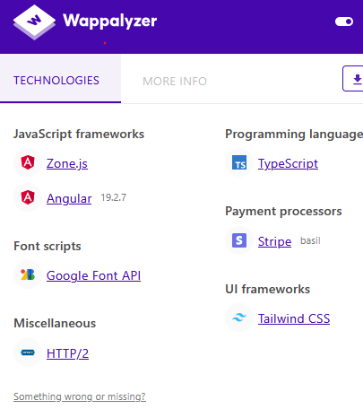
also robots.txt if there were any i dough we made something like that back then
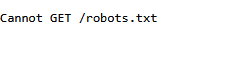

i can use waybackurl although i dough it might get us any thing cause the app didn't had much traffic but ok i will test on the old url when it was published 
`echo "target.com" | waybackurls | grep "admin"`

firsttouch.runasp.net

didn't find anything doesn't really matter that technique is for bugbounty programs not for our case here


5. Application Exploration
- Registration and authentication.
- User and administrator accounts.
- Main application features.
- HTTP requests and responses.
- Cookies and session behavior.


now i made an account to see if can go to another and do some stuff
this is the login 
then the post request 
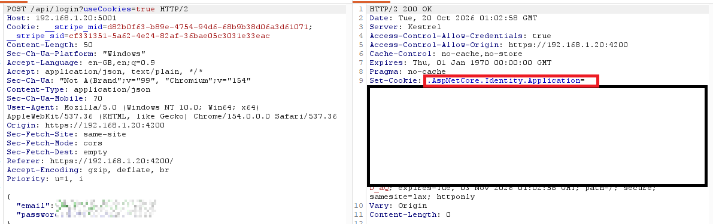

here we see the respond with the aspnetcore.identity.app which reveal the cookie identity of 
2 acc test1 and test2

when I try to buy 
actually there is something intresting like the number after payment here 
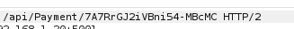
its related to the cart if cart empty and refill it changes sad


6. Manual Security Testing
- Input-handling tests.
- Initial XSS and SQLi checks.
- Cart manipulation.
- Checkout and payment manipulation.
- Order creation and database verification.
- User/admin authorization checks.


i will continue in the cart concept 
test the packets made by cart and see if any thing is exposed
when i asked for a packet 
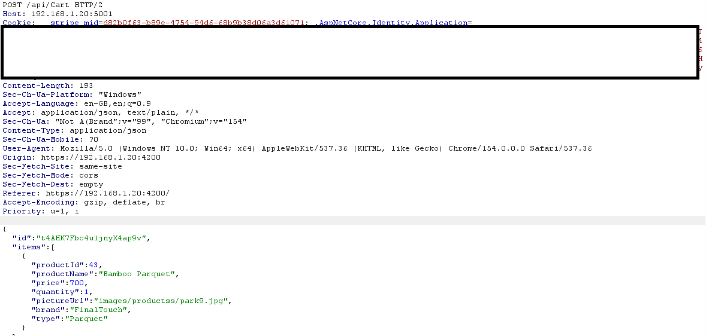
it shows the product id and id of the cart made also quantity 
when i forged the price to zero for example 
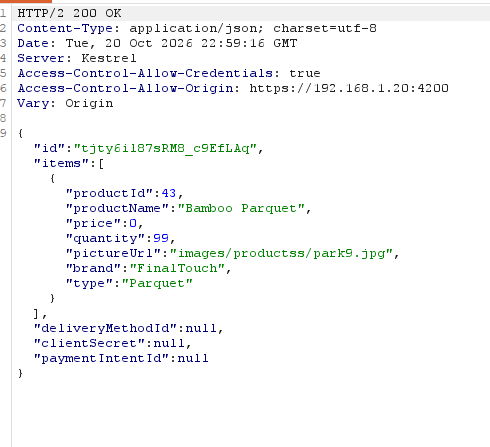


then we use that edited respond where it will save the output 
so we will try
we changed price to 1 and used another item 
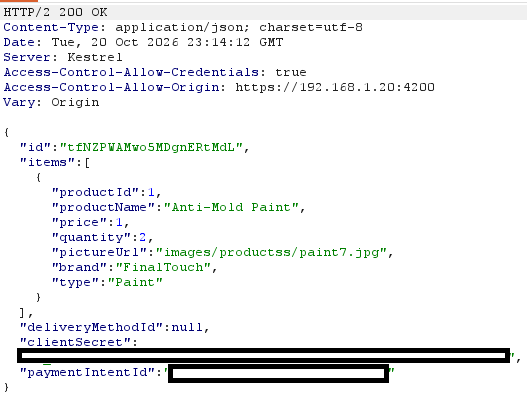
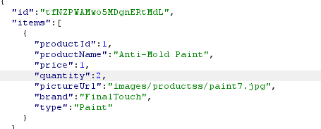

i changed the payment price order before the card added 
and i think it bought me the item with less money 
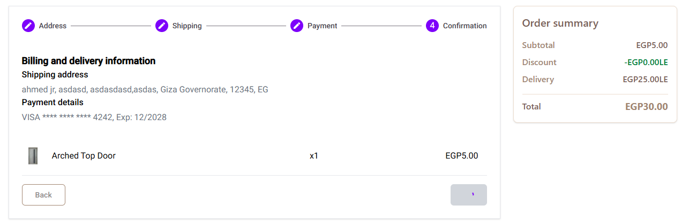

it didnt work its saved in the ui but the backend is linking the price with the product id itself so we will try and change it to a cheaper one
letst try something else like changing the id only of an item with a cheaper one

we knew item of id 34 is of a 160 pound 
so 
i willchange id from 1 to 34 
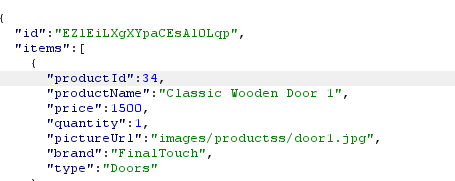

lets see
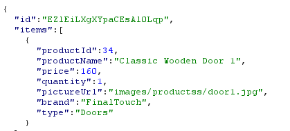
it changed the item but will it register as i bought the door with the price of item id no. 34
BINGO!!!
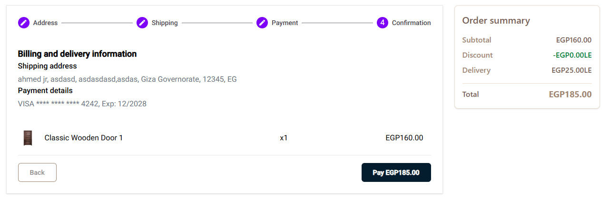
it made the delivery info with the door but with less price 
thats a business logic vuln 
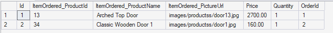
even in database its saved like that 
also in stripe 

so this one is business-logic/data-integrity vuln 

I checked admin that can see all users orders and none else can which is solid 

I tried to manipulate cart packet request to like add xss or sqli in it but didn't work tried on the main url or search didn't work

also outer of the testing I made a white box test like npm audit
and backages check which showed that the frontend framework needs to be upgraded as it has many vuln packages will discuss in owasp 10 supply chain 


7. Initial Observations and Potential Findings

The initial exploration identified several areas requiring further security assessment:

Development environment exposure: The frontend exposed Vite development-related resources, and malformed requests triggered an error response containing local file-path information.

Security configuration: A permissive CORS policy was temporarily configured for lab connectivity. Its behavior and security implications required separate validation.

Web content discovery: The application used SPA fallback behavior, affecting directory-enumeration results. An image directory and image metadata were also observed.

Authentication and authorization: Separate user accounts were created to examine authentication and order-access behavior. Cross-user order access was denied during testing.

Business logic: Manipulating the product identifier during checkout resulted in an order containing the original expensive product information while using the cheaper product's price. This was confirmed through the application, database records, and Stripe test mode.

Input handling: Initial XSS and SQL injection attempts did not produce confirmed vulnerabilities.

Dependency assessment: A separate frontend dependency audit identified packages requiring further review and potential updates.

These observations guided the subsequent structured OWASP Top 10 assessment. Confirmed vulnerabilities are documented separately in the findings section.


